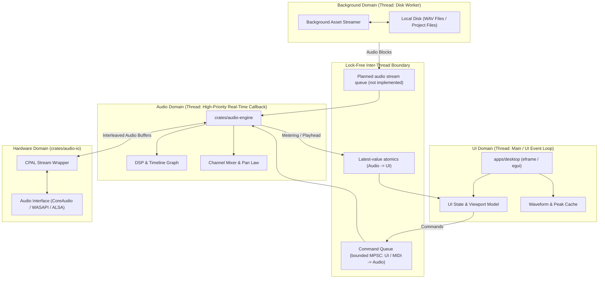
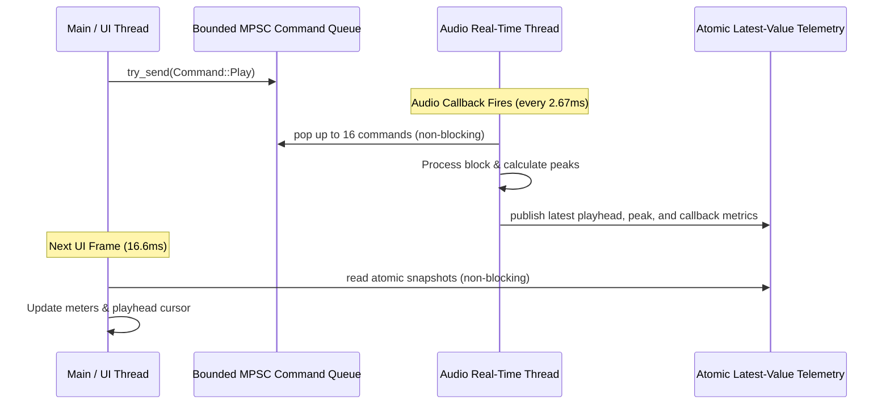
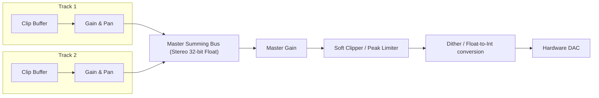

# System Architecture Document — Esperia

**Document Version:** 1.0.0  
**Status:** Approved / Active Architecture  
**Author:** Esperia Core Team  

---

## 1. High-Level Architectural Overview

Esperia is designed around the core principle of **strict thread isolation and deterministic lock-free data flow**. The system is partitioned into independent domains separated by bounded, lock-free communication channels.



---

## 2. Workspace & Crate Hierarchy

The repository is organized as a Cargo workspace with explicit dependency boundaries:

```
Esperia/
├── apps/desktop/                  # eframe/egui shell and application coordinator
├── crates/audio-io/               # CPAL devices and streams
├── crates/audio-engine/           # Audio processing and transport
├── crates/project-model/          # Project entities and persistence
├── crates/media/                  # Audio decoding and assets
├── crates/recording/              # Capture and recording workflow
├── crates/mixer/                  # Mixing and routing calculations
├── crates/midi/                   # MIDI and musical time
└── docs/                          # Architecture, specifications, and ADRs
```

### Module Dependency Rules:
1. `apps/desktop` coordinates the project model, UI, audio engine, audio I/O, media, recording, mixer, and MIDI.
2. `crates/audio-engine` contains pure DSP and synthesis logic and has ZERO dependencies on `audio-io`, CPAL, or GUI.
3. `crates/audio-io` provides hardware abstraction and has ZERO dependencies on `audio-engine` or `desktop`.
4. The real-time audio callback in `audio-engine` NEVER references GUI state directly.

---

## 3. Concurrency & Thread Isolation Model

Esperia enforces strict separation between four distinct execution threads:

| Thread Name | Priority | Responsibilities | Constraints |
| :--- | :--- | :--- | :--- |
| **Main / UI Thread** | Normal OS Priority | Windowing, user event processing, widget layout, 60 FPS drawing. | May allocate and perform UI operations. Never touches raw audio callback data directly. |
| **Audio Render Thread** | Real-Time / Audio Priority (`pthread_setschedparam`) | Evaluates timeline clips, applies volume/pan, sums tracks to master, fills hardware output buffer. | **STRICT REAL-TIME SAFETY:**<br>• No memory allocation (`malloc`, `free`, `Vec::push`)<br>• No mutexes, RwLocks, or blocking locks<br>• No file, socket, or console I/O<br>• No thread sleeping or indefinite looping |
| **Media/import workers** | Background | Decode/import work and project file I/O outside the callback. | May perform blocking operations; must not share those operations with the callback. |
| **Waveform worker** | Planned | Compute min/max peak caches asynchronously. | Not currently implemented as a separate worker. |

---

## 4. Real-Time Inter-Thread Communication



### Communication Invariants:
1. **Bounded channels:** Audio-facing queues are preallocated and expose explicit full/empty results. The command producer never overwrites unread commands.
2. **Callback budget:** The callback processes a fixed maximum number of control commands per block; sample work is bounded by the device buffer length.
3. **Telemetry policy:** Single-value metrics use latest-value atomics. Queue-backed telemetry discards the newest update when full; only its consumer advances the read cursor.
4. **Schedule lifetime:** Callback readers hold a guarded borrowed snapshot. The publisher retains old snapshots until readers are quiescent and reclaims them off the callback. Publication rejects updates at the fixed limit of 64 retained snapshots per schedule type.
5. **Mixer graph lifetime:** One pending and one retired graph slot are used. If retirement is occupied, replacement is deferred; the callback does not allocate or drop the old graph.
6. **Work bounds:** A callback processes at most 128 live MIDI events and 256 scheduled MIDI events per block. A MIDI backlog is preserved and counted in telemetry. Clip schedules cap at 4,096 clips; MIDI schedules at 1,000,000 events; mixer graphs at 4,096 channels, 512 buses, 8,192 sends, and 16,384 frames per preallocated buffer.
7. **Verification limits:** Saturation and ownership tests exist, but hardware timing and sustained stress behavior still require profiling before claiming production real-time performance.

---

## 5. Signal Pipeline & Data Flow



The diagram is the target signal path; a production limiter and output dither are not currently implemented.

### Signal Math:
- **Audio Sample Representation:** `f32` normalized to $[-1.0, +1.0]$, allowing intermediate mixing headroom up to $+770\text{ dB}$ before clipping.
- **Panning Law:** Constant-power $-3\text{ dB}$ circular panning:
  $$L = \cos\left(\frac{\pi}{4}(1 + p)\right) \cdot \text{signal}$$
  $$R = \sin\left(\frac{\pi}{4}(1 + p)\right) \cdot \text{signal}$$
  where $p \in [-1.0, +1.0]$.
- **Gain Smoothing:** Linear ramp interpolation across buffer frames ($N$ samples):
  $$g[n] = g_{\text{start}} + \frac{n}{N}(g_{\text{target}} - g_{\text{start}})$$

---

## 6. Project Data Model & Storage

Projects reside in self-contained directory bundles:
```
MySong.esperia/
├── project.json            # Human-readable project manifest
├── audio/                  # Audio pool (WAV files, imported assets)
│   ├── take_01.wav
│   └── drum_loop.wav
└── cache/                  # Waveform peak cache (.peaks binary files)
```

### Data Schema Representation:
```json
{
  "version": "1.0.0",
  "project_name": "MySong",
  "sample_rate": 48000,
  "tempo_bpm": 120.0,
  "time_signature": [4, 4],
  "tracks": [
    {
      "id": "uuid-v4",
      "name": "Drums",
      "volume_db": -2.5,
      "pan": 0.0,
      "muted": false,
      "soloed": false,
      "clips": [
        {
          "id": "uuid-v4",
          "asset_relative_path": "audio/drum_loop.wav",
          "timeline_start_frame": 0,
          "source_offset_frame": 0,
          "duration_frames": 96000
        }
      ]
    }
  ]
}
```

---

## 7. Architecture Decision Records (ADRs)

| ADR ID | Decision Title | Status | Rationale |
| :--- | :--- | :--- | :--- |
| **ADR-0001** | Rust as Primary Language | Accepted | Memory safety without garbage collection pauses; zero-cost abstractions; fearless concurrency. |
| **ADR-0002** | Desktop UI and Rendering | Accepted | eframe/egui uses one shared window, input, and wgpu rendering stack. |
| **ADR-0003** | CPAL for Audio I/O | Accepted | Native multi-platform hardware binding for CoreAudio, WASAPI, and ALSA/Pulse. |
| **ADR-0004** | Cargo Workspace Architecture | Accepted | Enforces clean crate boundaries between UI, engine, and hardware abstraction. |
| **ADR-0005** | Strict Audio Thread Isolation | Accepted | Defines callback constraints, bounded queues, and off-thread reclamation rules. |
| **ADR-0006** | Directory-Bundle Project Format | Accepted | Simplifies portability, backup, and sample referencing while keeping manifests human-readable. |
