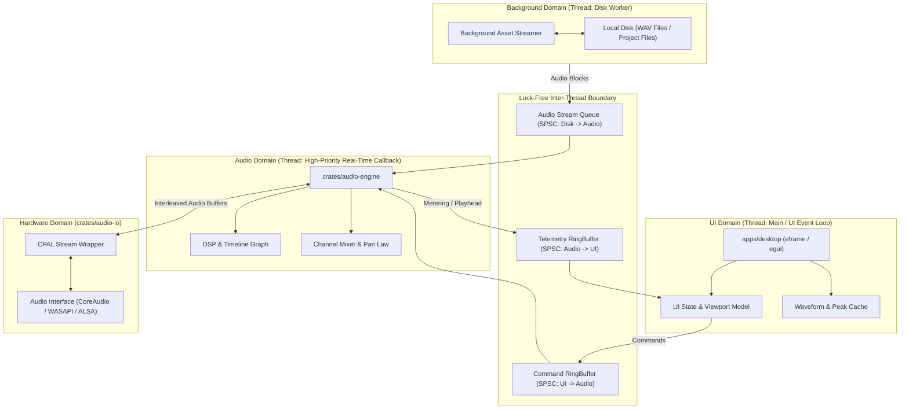
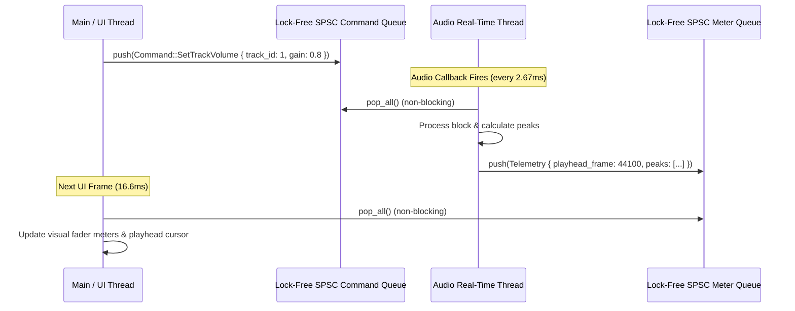
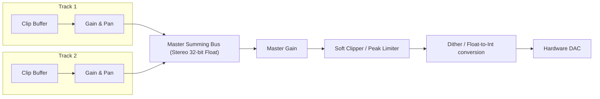

# System Architecture Document — Resonance

**Document Version:** 1.0.0  
**Status:** Approved / Active Architecture  
**Author:** Resonance Core Team  

---

## 1. High-Level Architectural Overview

Resonance is designed around the core principle of **strict thread isolation and deterministic lock-free data flow**. The system is partitioned into independent domains separated by bounded, lock-free communication channels.



---

## 2. Workspace & Crate Hierarchy

The repository is organized as a Cargo workspace with explicit dependency boundaries:

```
Esperia/
├── Cargo.toml                     # Root workspace manifest (resolver = "3")
├── apps/
│   └── desktop/                   # Resonance desktop binary (GUI, menus, interactions)
│       ├── Cargo.toml
│       └── src/
│           ├── main.rs            # Application entrypoint
│           ├── app.rs             # Eframe/egui application loop
│           ├── ui/                # UI panels (Transport, Arrangement, Mixer, Inspector)
│           └── state.rs           # Client-side presentation state
├── crates/
│   ├── audio-engine/              # Real-time audio graph and DSP processing
│   │   ├── Cargo.toml
│   │   └── src/
│   │       ├── lib.rs             # Engine API & real-time callback implementation
│   │       ├── graph.rs           # Track and node evaluation graph
│   │       ├── mixer.rs           # Channel strips, gain staging, panning laws
│   │       ├── transport.rs       # Sample-accurate clock, loop logic, playhead
│   │       └── ringbuffer.rs      # Bounded lock-free ring buffers
│   └── audio-io/                  # Audio device management & CPAL abstraction
│       ├── Cargo.toml
│       └── src/
│           ├── lib.rs             # Device discovery, stream creation
│           └── device.rs          # Input/output stream configurations & error recovery
└── docs/                          # Architecture, SRS, PRD, specifications
```

### Module Dependency Rules:
1. `apps/desktop` depends on `crates/audio-engine` and `crates/audio-io`.
2. `crates/audio-engine` depends on `crates/audio-io`.
3. `crates/audio-io` has zero knowledge of `audio-engine` or `desktop`.
4. The real-time audio callback in `audio-engine` NEVER references GUI state directly.

---

## 3. Concurrency & Thread Isolation Model

Resonance enforces strict separation between four distinct execution threads:

| Thread Name | Priority | Responsibilities | Constraints |
| :--- | :--- | :--- | :--- |
| **Main / UI Thread** | Normal OS Priority | Windowing, user event processing, widget layout, 60 FPS drawing. | May allocate and perform UI operations. Never touches raw audio callback data directly. |
| **Audio Render Thread** | Real-Time / Audio Priority (`pthread_setschedparam`) | Evaluates timeline clips, applies volume/pan, sums tracks to master, fills hardware output buffer. | **STRICT REAL-TIME SAFETY:**<br>• No memory allocation (`malloc`, `free`, `Vec::push`)<br>• No mutexes, RwLocks, or blocking locks<br>• No file, socket, or console I/O<br>• No thread sleeping or indefinite looping |
| **Disk I/O Worker** | Low/Background Priority | Pre-reads upcoming audio clips from disk into RAM ring buffers, encodes recorded takes, writes project files. | Allowed to make blocking file system calls. |
| **Waveform Worker** | Low/Background Priority | Computes min/max peak caches from imported audio files for smooth UI zooming. | Computes asynchronously, dispatches finished mipmaps to UI. |

---

## 4. Real-Time Inter-Thread Communication



### Communication Invariants:
1. **Single-Producer Single-Consumer (SPSC):** All channels between threads use bounded, pre-allocated lock-free atomic queues.
2. **Fixed Memory Footprint:** The command queue and telemetry queue are allocated at startup with fixed capacities (e.g., 1024 messages).
3. **Drop Policy:** If telemetry queues fill up (e.g. UI freezes for a moment), the audio thread drops the oldest telemetry frame; it NEVER blocks waiting for the UI to consume.

---

## 5. Signal Pipeline & Data Flow



### Signal Math:
- **Audio Sample Representation:** `f32` normalized to $[-1.0, +1.0]$, allowing intermediate mixing headroom up to $+770\text{ dB}$ before clipping.
- **Panning Law:** Constant-power $-3\text{ dB}$ circular panning:
  $$L = \cos\left(\frac{\pi}{4}(1 + p)\right) \cdot \text{signal}$$
  $$R = \sin\left(\frac{\pi}{4}(1 + p)\right) \cdot \text{signal}$$
  where $p \in [-1.0, +1.0]$.
- **Gain Smoothing:** Linear ramp interpolation across buffer frames ($N$ samples):
  $$g[n] = g_{\text{start}} + \frac{n}{N}(g_{\text{target}} - g_{\text{start}})$$

---

## 6. Project Data Model & Storage

Projects reside in self-contained directory bundles:
```
MySong.resonance/
├── project.json            # Human-readable project manifest
├── audio/                  # Audio pool (WAV files, imported assets)
│   ├── take_01.wav
│   └── drum_loop.wav
└── cache/                  # Waveform peak cache (.peaks binary files)
```

### Data Schema Representation:
```json
{
  "version": "1.0.0",
  "project_name": "MySong",
  "sample_rate": 48000,
  "tempo_bpm": 120.0,
  "time_signature": [4, 4],
  "tracks": [
    {
      "id": "uuid-v4",
      "name": "Drums",
      "volume_db": -2.5,
      "pan": 0.0,
      "muted": false,
      "soloed": false,
      "clips": [
        {
          "id": "uuid-v4",
          "asset_relative_path": "audio/drum_loop.wav",
          "timeline_start_frame": 0,
          "source_offset_frame": 0,
          "duration_frames": 96000
        }
      ]
    }
  ]
}
```

---

## 7. Architecture Decision Records (ADRs)

| ADR ID | Decision Title | Status | Rationale |
| :--- | :--- | :--- | :--- |
| **ADR-0001** | Rust as Primary Language | Accepted | Memory safety without garbage collection pauses; zero-cost abstractions; fearless concurrency. |
| **ADR-0002** | Immediate/Retained GUI Selection | Accepted | `eframe` (egui) / `vizia` allows immediate visual prototyping and fast GPU rendering with minimal boilerplate. |
| **ADR-0003** | CPAL for Audio I/O | Accepted | Native multi-platform hardware binding for CoreAudio, WASAPI, and ALSA/Pulse. |
| **ADR-0004** | Cargo Workspace Architecture | Accepted | Enforces clean crate boundaries between UI, engine, and hardware abstraction. |
| **ADR-0005** | Strict Audio Thread Isolation | Accepted | Eliminates priority inversion, dropouts, and UI stalls by banning allocations/mutexes in the callback. |
| **ADR-0006** | Directory-Bundle Project Format | Accepted | Simplifies portability, backup, and sample referencing while keeping manifests human-readable. |
