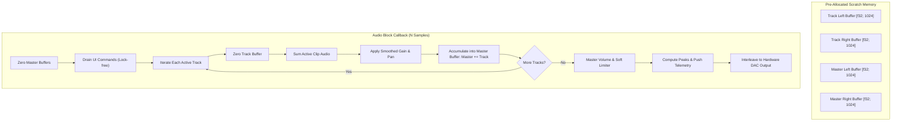

# Audio Engine Specification — Esperia

**Document Version:** 1.0.0  
**Status:** Approved / Active Specification  
**Crate:** `crates/audio-engine`  

---

## 1. Engine Core & Mathematical Foundations

### 1.1 Sample Format & Precision
- **Internal Processing Standard:** IEEE 754 32-bit single-precision floating point (`f32`).
- **Normalized Range:** Nominal full scale is $[-1.0, +1.0] \equiv 0.0\text{ dBFS}$.
- **Headroom Policy:** Processing buffers retain values $> +1.0$ without intermediate clipping during track summing. Hard clipping only occurs at the final physical DAC output boundary unless a master soft-clipper/limiter is active.
- **Channel Layout:** Non-interleaved (planar) stereo channels `[Vec<f32>; 2]` internally to maximize SIMD vectorization efficiency, converting to/from interleaved format at the hardware callback boundary in `audio-io`.

---

## 2. Real-Time Audio Callback Contract

The audio engine processes samples within a high-priority hardware callback provided by the platform driver via `cpal`.

### 2.1 Latency & Execution Deadlines
The callback period $T_{\text{period}}$ is defined by:
$$T_{\text{period}} = \frac{N_{\text{buffer}}}{f_s}$$
where $N_{\text{buffer}}$ is the buffer size in frames, and $f_s$ is the sampling frequency.

| Buffer Size ($N$) | Sample Rate ($f_s$) | Total Available Window | Hard Engine Deadline ($< 45\%$) |
| :---: | :---: | :---: | :---: |
| 64 samples | 48,000 Hz | $1.33\text{ ms}$ | **$0.60\text{ ms}$** |
| 128 samples | 48,000 Hz | $2.67\text{ ms}$ | **$1.20\text{ ms}$** |
| 256 samples | 48,000 Hz | $5.33\text{ ms}$ | **$2.40\text{ ms}$** |
| 512 samples | 48,000 Hz | $10.67\text{ ms}$ | **$4.80\text{ ms}$** |

### 2.2 Prohibited Operations (Real-Time Safety Rules)
Violating any of these rules within the audio callback constitutes an architectural failure:
1. **NO Memory Allocation / Deallocation:** Calls to `malloc`, `free`, `realloc`, or Rust functions that can allocate (e.g. `Vec::push`, `Box::new`, `String::from`) are forbidden. All scratch buffers are pre-allocated during engine initialization.
2. **NO Blocking Synchronization:** Mutexes (`std::sync::Mutex`), read-write locks (`RwLock`), and thread parking are forbidden. Inter-thread communication must use wait-free/lock-free atomic ringbuffers.
3. **NO File / Network / Terminal I/O:** Reading files, socket calls, and formatting strings to stdout/stderr or disk loggers are forbidden.
4. **NO System Calls:** Any kernel trap that can yield thread execution (such as `thread::sleep`) is strictly prohibited.

---

## 3. Buffers, Sample Rates & Clocking

### 3.1 Supported Configurations
- **Sample Rates ($f_s$):** $44.1\text{ kHz}, 48.0\text{ kHz}, 88.2\text{ kHz}, 96.0\text{ kHz}, 192.0\text{ kHz}$.
- **Buffer Sizes ($N$):** $32, 64, 128, 256, 512, 1024, 2048$ samples.

### 3.2 Timebase & Transport Tracking
The engine uses an integer sample-frame counter for continuous timebase representation:
- **`current_frame: u64`:** Monotonically incremented by $N$ frames on each rendered audio block.
- **Conversion to Seconds:**
  $$t = \frac{\text{current\_frame}}{f_s}$$
- **Musical Clock Conversion:**
  $$\text{beats} = t \cdot \left(\frac{\text{BPM}}{60}\right)$$
  $$\text{bar} = \left\lfloor \frac{\text{beats}}{\text{beats\_per\_bar}} \right\rfloor + 1$$

---

## 4. Track Summing & Mixing Architecture

### 4.1 Clip Scheduling Logic
For each track:
1. Identify all clips whose time interval $[\text{start\_frame}, \text{end\_frame})$ overlaps with current render block $[\text{block\_start}, \text{block\_start} + N)$.
2. Calculate slice offsets:
   $$\text{offset}_{\text{dest}} = \max(0, \text{clip.start} - \text{block\_start})$$
   $$\text{offset}_{\text{source}} = \text{clip.source\_offset} + (\text{block\_start} + \text{offset}_{\text{dest}} - \text{clip.start})$$
   $$\text{length} = \min(N - \text{offset}_{\text{dest}}, \text{clip.end} - (\text{block\_start} + \text{offset}_{\text{dest}}))$$
3. Copy/add samples into the track scratch buffer with gain envelope applied.

### 4.2 Constant-Power Panning Law
For a stereo track with pan parameter $p \in [-1.0, +1.0]$:
$$\theta = \frac{\pi}{4}(p + 1)$$
$$G_L = \cos(\theta), \quad G_R = \sin(\theta)$$
At center ($p = 0$): $\theta = \frac{\pi}{4}$, $G_L = G_R = \frac{\sqrt{2}}{2} \approx 0.7071$ ($-3.01\text{ dB}$ attenuation on both channels).

### 4.3 Parameter Smoothing
To eliminate zipper noise, track gains and pan factors are smoothed using a one-pole low-pass filter:
$$y[n] = \alpha \cdot y[n-1] + (1 - \alpha) \cdot x_{\text{target}}$$
where $\alpha = e^{-1 / (\tau \cdot f_s)}$ with a smoothing time constant $\tau \approx 10\text{ ms}$.

---

## 5. Master Peak & Metering Subsystem

At the conclusion of each block render:
1. **True Peak Calculation:**
   $$\text{Peak}_L = \max_{0 \le n < N} |x_L[n]|, \quad \text{Peak}_R = \max_{0 \le n < N} |x_R[n]|$$
2. **RMS Calculation:**
   $$\text{RMS} = \sqrt{\frac{1}{N} \sum_{n=0}^{N-1} x^2[n]}$$
3. **Decibel Conversion:**
   $$\text{dBFS} = 20 \log_{10}(\text{Peak})$$
4. **Lock-Free Dispatch:**
   The calculated peak and RMS values, alongside the current playhead frame, are placed into an SPSC ring buffer for the UI thread. If the buffer is full, the audio thread overwrites the unread entry (lossy telemetry is permissible; stalling is not).

---

## 6. Recording & Capture Architecture

1. **Input Callback:** The hardware capture callback receives incoming ADC samples.
2. **Pre-Allocated Capture Ringbuffer:** Samples are written directly to a bounded lock-free ringbuffer.
3. **Background Disk Writer:** A dedicated disk thread reads chunks from the capture ringbuffer and encodes them as linear PCM WAV data on disk.
4. **Zero Latency Monitoring:** If track input monitoring is enabled, the incoming samples are routed directly into the track's mixer strip in the playback graph.

