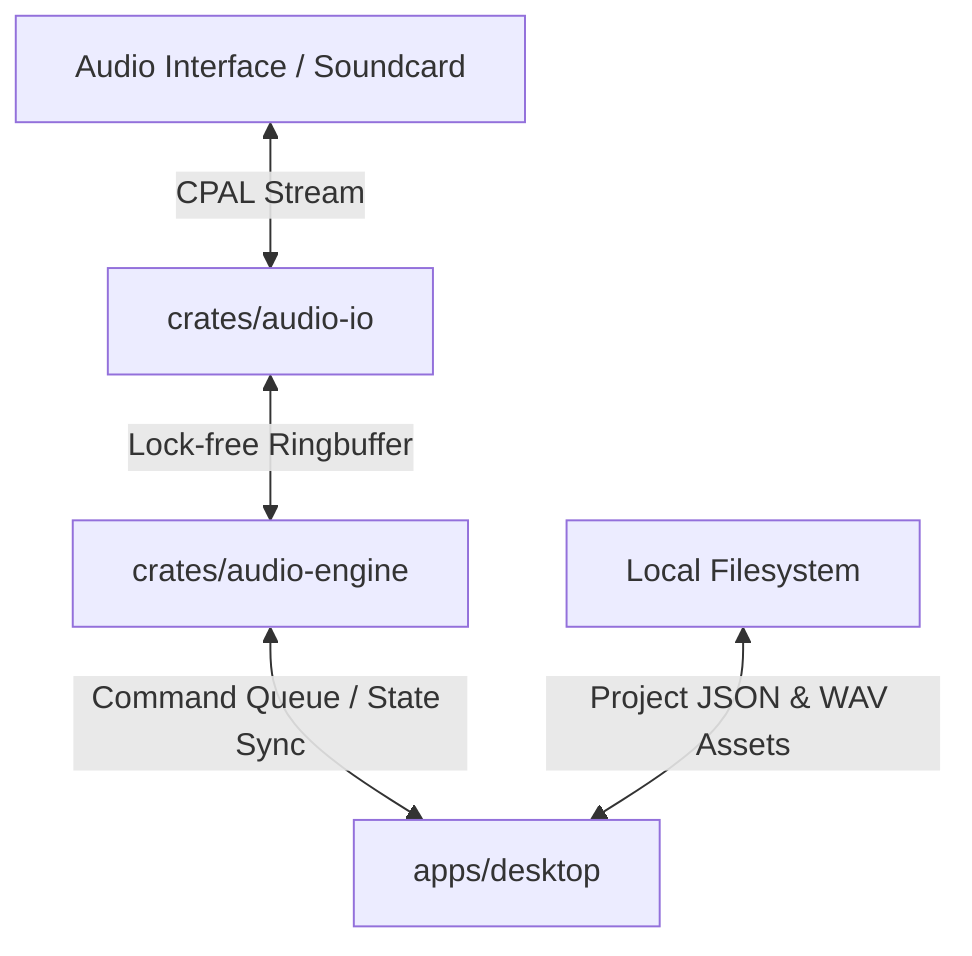

# Software Requirements Specification (SRS) — Resonance

**Document Version:** 1.0.0  
**Status:** Approved / Active Specification  
**Standard:** IEEE 830 / ISO/IEC/IEEE 29148 Compliant Adaptation  

---

## 1. Introduction

### 1.1 Purpose
This document provides complete, verifiable functional and non-functional requirements for the **Resonance** Digital Audio Workstation. It guides implementation, verification, and automated testing across all workspace crates.

### 1.2 Scope
Resonance is a desktop software application for multi-track audio recording, editing, mixing, and offline rendering on macOS, Windows, and Linux.

### 1.3 Definitions and Acronyms
- **AudioSource:** A decoded or memory-mapped audio asset (e.g. PCM WAV file) resident on disk or in the asset cache.
- **Audio Clip:** An instance of an AudioSource placed on the timeline at a specific timeline position, with source start/end trim points and gain/fade envelopes.
- **Track:** A sequential lane in the arrangement that holds audio clips, routing its summed output into a channel strip in the mixer.
- **Bus:** An intermediate summing node that combines signals from multiple tracks or busses before routing to the master output.
- **CPAL:** Cross-Platform Audio Library used for hardware device enumeration and callback management.
- **XRun:** Buffer under-run or overrun resulting in audible clicks/pops due to missed real-time deadlines.
- **Lock-Free:** Concurrency technique guaranteeing system-wide progress without mutual exclusion locks (mutexes).

---

## 2. Overall Description

### 2.1 Product Perspective
Resonance is structured as a modular Rust workspace:
- `apps/desktop`: Native GUI frontend presenting the arrangement, timeline, mixer, and controls.
- `crates/audio-engine`: Real-time audio graph, track summing, clip scheduling, and lock-free message handling.
- `crates/audio-io`: Hardware interface layer wrapping CPAL streams and sample format conversions.

### 2.2 System Interfaces

---

## 3. Functional Requirements

### 3.1 Project Management (FR-PRJ)
| ID | Requirement Statement | Priority | Verification Method |
| :--- | :--- | :--- | :--- |
| **FR-PRJ-001** | The application shall allow the user to create a new, empty project with configurable sample rate (44.1 kHz, 48 kHz, 96 kHz) and tempo (20 - 300 BPM). | High | Integration Test |
| **FR-PRJ-002** | The application shall serialize the entire project state (tracks, clips, mixer settings, timeline markers) into a human-readable JSON project file (`project.resonance`). | High | Unit & Persistence Test |
| **FR-PRJ-003** | The application shall open previously saved `.resonance` projects and restore state with sample-accurate fidelity. | High | Persistence Test |
| **FR-PRJ-004** | The application shall perform atomic saves using a write-to-temporary-file and rename pattern to prevent corruption on crash or power failure. | High | Automated Fault Test |
| **FR-PRJ-005** | The application shall prompt to save unsaved changes before exiting or creating a new project. | Medium | Manual UI Test |

### 3.2 Asset Ingestion & Audio I/O (FR-AST)
| ID | Requirement Statement | Priority | Verification Method |
| :--- | :--- | :--- | :--- |
| **FR-AST-001** | The application shall import standard linear PCM WAV files (16-bit, 24-bit, 32-bit float, mono and stereo). | High | File Import Test |
| **FR-AST-002** | The application shall automatically resample imported audio files whose native sample rate differs from the active project sample rate using band-limited sinc interpolation. | High | DSP Unit Test |
| **FR-AST-003** | The application shall generate visual waveform peak overviews asynchronously on a background worker thread without blocking the UI or audio thread. | High | Stress / Perf Test |
| **FR-AST-004** | The application shall copy imported external audio files into a project-local `audio/` directory upon save when requested. | Medium | Integration Test |

### 3.3 Transport & Timeline Scheduling (FR-TRN)
| ID | Requirement Statement | Priority | Verification Method |
| :--- | :--- | :--- | :--- |
| **FR-TRN-001** | The application shall support Start, Stop, Pause, and Return-to-Zero transport operations via UI buttons and the Spacebar shortcut. | High | UI / Audio Test |
| **FR-TRN-002** | The transport playhead shall maintain sample-accurate position tracking synchronized with audio hardware sample frames. | High | Audio Integration Test |
| **FR-TRN-003** | The application shall support looping within user-defined loop start and loop end markers with zero-latency boundary wrapping. | High | DSP Integration Test |
| **FR-TRN-004** | The user shall be able to seek to any position on the timeline during playback without causing audio artifacts or thread deadlocks. | High | Realtime Stress Test |

### 3.4 Arrangement & Editing (FR-ARR)
| ID | Requirement Statement | Priority | Verification Method |
| :--- | :--- | :--- | :--- |
| **FR-ARR-001** | The application shall allow adding, removing, reordering, and renaming audio tracks. | High | UI & Engine Test |
| **FR-ARR-002** | The user shall place, move, and duplicate audio clips horizontally across time and vertically across tracks of matching channel configurations. | High | Timeline Edit Test |
| **FR-ARR-003** | The user shall trim the left and right boundaries of an audio clip non-destructively. | High | Engine Unit Test |
| **FR-ARR-004** | The user shall split an audio clip at the current playhead position into two discrete non-destructive clip segments. | High | Engine Unit Test |
| **FR-ARR-005** | The user shall configure fade-in and fade-out linear or equal-power gain curves on any clip. | Medium | DSP Math Test |
| **FR-ARR-006** | The timeline shall support configurable grid snapping to bars, beats (1/4, 1/8, 1/16, 1/32) and free un-snapped movement. | High | UI Functional Test |

### 3.5 Mixer & Signal Routing (FR-MIX)
| ID | Requirement Statement | Priority | Verification Method |
| :--- | :--- | :--- | :--- |
| **FR-MIX-001** | Each track channel strip shall provide a volume fader calibrated from $-\infty\text{ dB}$ to $+6.0\text{ dB}$, with $0.0\text{ dB}$ default unity gain. | High | Mixer DSP Test |
| **FR-MIX-002** | Each track channel strip shall provide a stereo pan control adhering to a $-3.0\text{ dB}$ constant-power panning law. | High | DSP Math Test |
| **FR-MIX-003** | Each track shall support Mute and Solo states, where soloing one or more tracks mutes all non-soloed tracks without altering their individual mute toggles. | High | Logic Verification Test |
| **FR-MIX-004** | All active audio tracks shall sum into a Master stereo channel strip equipped with master volume and peak limiting protection. | High | Summing Audio Test |
| **FR-MIX-005** | Track volume and pan parameter changes from the UI shall be smoothly interpolated over audio blocks to prevent zipper noise. | High | FFT Glitch Test |

### 3.6 Metering & Monitoring (FR-MTR)
| ID | Requirement Statement | Priority | Verification Method |
| :--- | :--- | :--- | :--- |
| **FR-MTR-001** | The application shall calculate and display Peak and RMS level meters for each channel strip and the master bus. | High | Metering Test |
| **FR-MTR-002** | Meter data shall be dispatched from the audio thread to the UI thread via lock-free ring buffers at a minimum refresh rate of 30 Hz. | High | Thread Profiler Test |
| **FR-MTR-003** | The meters shall render a persistent clip indicator whenever a sample value reaches or exceeds $0.0\text{ dBFS}$ ($1.0$ float). | Medium | Visual Test |

### 3.7 Offline Render & Export (FR-RND)
| ID | Requirement Statement | Priority | Verification Method |
| :--- | :--- | :--- | :--- |
| **FR-RND-001** | The application shall render the master mix offline to 16-bit, 24-bit, or 32-bit float WAV files at project sample rate. | High | Render Comparison Test |
| **FR-RND-002** | Offline rendering shall execute at faster-than-realtime speeds using dedicated worker threads. | High | Performance Benchmark |
| **FR-RND-003** | The exported audio stream shall bit-accurately match the mathematical sum produced during real-time playback. | High | Golden Master Diff Test |

---

## 4. Non-Functional Requirements

### 4.1 Real-Time Audio Constraints (NFR-RT)
- **NFR-RT-001 (Zero Allocations):** The real-time audio render callback shall make zero memory allocations (`malloc`, `free`, `realloc`, or Rust container expansions) after initialization.
- **NFR-RT-002 (Zero Blocking Synchronization):** The audio callback shall never acquire standard OS mutexes, condition variables, or perform blocking channel operations. Lock-free queues (e.g. SPSC atomics) shall be used exclusively.
- **NFR-RT-003 (Zero Syscalls):** The audio callback shall execute zero file I/O, socket operations, logging to disk/stdout, or thread sleep syscalls.
- **NFR-RT-004 (Execution Budget):** For a buffer size of 128 samples at 48.0 kHz ($2.67\text{ ms}$ total window), the entire graph processing pass must complete within $\le 1.20\text{ ms}$ ($< 45\%$ execution budget) on reference desktop hardware.

### 4.2 Audio Fidelity (NFR-AUD)
- **NFR-AUD-001:** All internal signal paths, summing, and DSP calculations shall use 32-bit IEEE 754 floating-point values (`f32`) with headroom above $0.0\text{ dBFS}$.
- **NFR-AUD-002:** The system shall prevent sample drift between audio hardware output clock and timeline position tracking.

### 4.3 UI Performance & Responsiveness (NFR-UI)
- **NFR-UI-001:** The graphical user interface shall maintain a consistent 60 FPS update rate during playback on supported displays.
- **NFR-UI-002:** User actions (clicking Play, dragging a fader) must visibly update and dispatch commands to the engine within $16\text{ ms}$.

### 4.4 Memory & Resource Management (NFR-MEM)
- **NFR-MEM-001:** Audio files shall be streamed from disk using ring buffers or pre-allocated block caches; files must not be loaded wholly into unmanaged RAM without size bounds.
- **NFR-MEM-002:** The baseline idle application memory footprint (without open projects) shall not exceed 120 MB RAM.

### 4.5 Cross-Platform Portability (NFR-PLT)
- **NFR-PLT-001:** The codebase shall compile and run natively on:
  - macOS (Apple Silicon & x86_64, CoreAudio backend).
  - Windows (x86_64, WASAPI backend).
  - Linux (x86_64, ALSA / PulseAudio / PipeWire backends).

### 4.6 Crash Resilience & Data Integrity (NFR-REL)
- **NFR-REL-001:** If the audio hardware is unplugged or disconnected, the application shall safely transition the transport to Stopped without panicking or crashing.
- **NFR-REL-002:** Project saves shall be verified with checksum checks to ensure zero file corruption.
